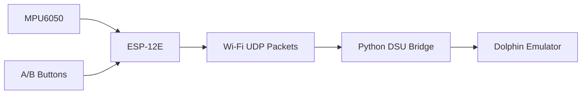

# ESP-12E Wii Remote

## Goal :

- Build a wireless Wii Remote-style controller using an ESP-12E and an MPU6050 motion sensor
- Send motion data and button inputs to a PC over Wi-Fi
- Use the controller with the Dolphin Wii emulator
- Read gyroscope and accelerometer data to control motion
- Create a low-cost alternative to a physical Wii Remote

## Hardware :

- ESP-12E / ESP8266 (an ESP-32 would be better but this is what I have on hand)
- MPU6050 / MPU-6500 IMU
- 2 push buttons (A and B)
- Connecting wires

## Processing

The ESP-12E reads the accelerometer, gyroscope and button inputs, then sends the data to the PC using UDP.

A Python bridge processes the received data and makes it available to Dolphin through the DSU/Cemuhook protocol.

## Connections

| Component   | ESP-12E     |
| ----------- | ----------- |
| MPU6050 SDA | D2 / GPIO4  |
| MPU6050 SCL | D1 / GPIO5  |
| Button A    | D5 / GPIO14 |
| Button B    | D6 / GPIO12 |
| MPU6050 VCC | 3.3V        |
| MPU6050 GND | GND         |

## Communication

The ESP-12E sends the following data over UDP on port `4210`:

- A and B button states
- Accelerometer X, Y and Z
- Gyroscope X, Y and Z

The Python bridge receives the packets and converts the sensor data for use in Dolphin.

## Current Progress

- ESP-12E Wi-Fi communication working 
- A/B button inputs working
- MPU6050 motion data received by the Python bridge
- Gyroscope axis mapping configured for Dolphin
- Accelerometer axis mapping and in-game pointer behaviour still being worked on

## Example

The controller can be used to test motion input in Dolphin and experiment with using an IMU as a Wii Remote replacement.
